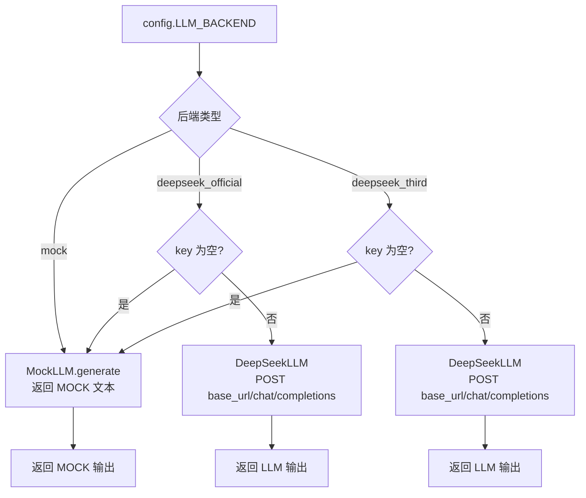
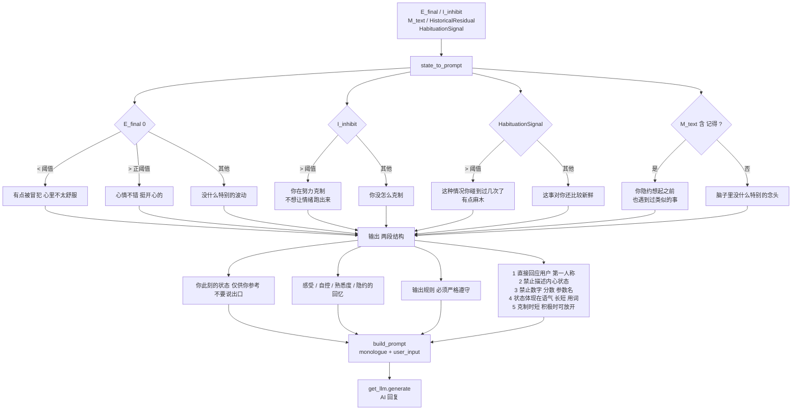
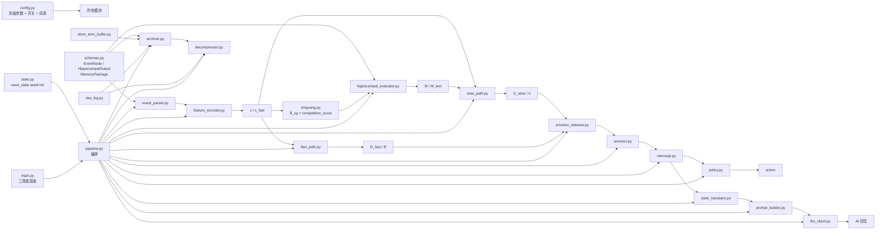
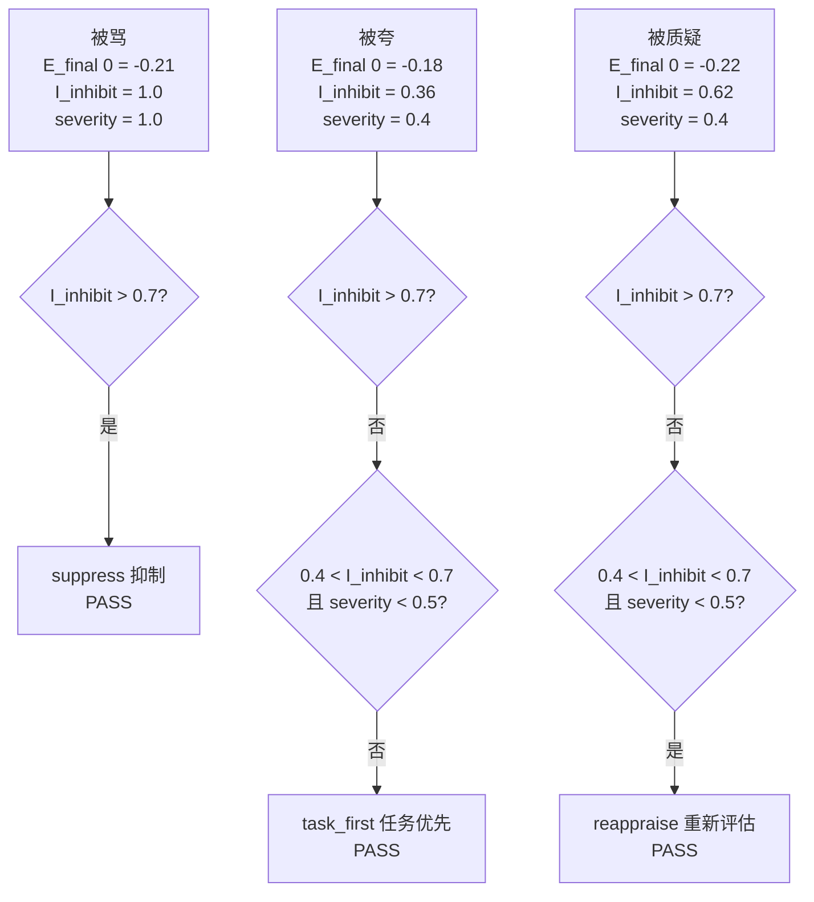

# 小凌情绪 Agent · 全链路图（V4.4）

> **版本**：V4.4（M2 封版） | **日期**：2026-10-06 | **范围**：从用户输入到 AI 回复的完整数据流

---

## 一、主链路总览

```mermaid
graph TD
    U[用户输入] --> EP[1. event_parser.parse<br/>事件拆解]
    EP --> EN[EventNode<br/>raw_text / event_embedding<br/>nodes / persons(空) / tasks(空)]
    EN --> FE[2. feature_encoder.encode<br/>特征编码]
    FE --> X[x 8维 慢通路输入<br/>x_fast 4维 快通路输入]
    X --> XG[3. xinguang.update_xinguang_budget<br/>心光预算]
    XG --> BXG[B_xg]
    BXG --> HP[4. hippocampal_evaluator.evaluate<br/>海马体评估]
    HP --> OUT_M[M 8维 / ReframedContext<br/>HabituationSignal / HistoricalResidual<br/>M_text / MatchedMemories]
    OUT_M --> READ[5. 读取侧<br/>MEMORY_READ_ENABLED=True]
    READ --> RECALL[recalled_memory<br/>暂不影响评估]
    OUT_M --> FP[6. fast_path.run_fast_path<br/>快通路]
    FP --> DF[D_fast / B]
    OUT_M --> SP[7. slow_path.run_slow_path<br/>慢通路 复用 M]
    SP --> DS[D_slow / V]
    DF --> ER[8. emotion_releaser.run_releaser<br/>释放器]
    DS --> ER
    ER --> REL[raw_emotion_impact<br/>released_impact / release_rate]
    REL --> EM[9. emotion.run_emotion<br/>情绪加点]
    EM --> ERAW[E_raw]
    ERAW --> IC[10. intercept.run_intercept<br/>拦截层 PFC 抑制]
    IC --> EFIN[E_final / I_inhibit<br/>w_PFC_new]
    EFIN --> POL[11. policy.policy_minimal<br/>策略]
    POL --> ACT[action<br/>suppress / reappraise<br/>task_first / express / ask_clarify]
    EFIN --> ST[12. state_translator.state_to_prompt<br/>状态翻译]
    ST --> MONO[monologue<br/>心理独白]
    MONO --> PB[13. prompt_builder.build_prompt<br/>Prompt 组装]
    PB --> PROMPT[prompt]
    PROMPT --> LLM[14. llm_client.get_llm.generate<br/>LLM 调用]
    LLM --> OUT[llm_output<br/>AI 回复]
    OUT --> WB[15. 回写识海<br/>danger_score = clip V1*2-0.5]
    WB --> MG[memory_graph.add]
    MG --> SU[16. 状态更新<br/>E_prev / w_PFC / B / M_prev / HabituationSignal_prev]
    SU --> WRITE[17. 写入侧<br/>MEMORY_WRITE_ENABLED=True]
    WRITE --> BUF[memory_buffer.append]
    BUF --> ARCH[archiver.archive<br/>达阈值 6 触发]
    ARCH --> PKG[MemoryPackage]
    PKG -.->|下一轮读取| READ
```

---

## 二、记忆通路详图

```mermaid
graph LR
    SUBGRAPH 每轮写入
        A[本轮对话] --> B[memory_buffer.append<br/>round_id / user_input / ai_output / timestamp]
        B --> C{len >= 6 ?}
        C -->|否| D[继续累积]
        C -->|是| E[archiver.archive]
    end

    SUBGRAPH 归档流程
        E --> F[buffer.flush_keep_recent 2]
        F --> G[吐出 flushed 前 N-2 轮]
        F --> H[保留 最近 2 轮]
        G --> I[raw_log.append 每轮<br/>按 round_id 存原文]
        I --> J[organize_narrative flushed]
        J --> K{LLM_BACKEND}
        K -->|mock| L[桩逻辑 固定拼接]
        K -->|deepseek_*| M[真 LLM 生成 JSON]
        L --> N[MemoryPackage]
        M --> N
        N --> O[存入 _packages]
    end

    SUBGRAPH 下一轮读取
        O --> P[packages = archiver.get_packages]
        P --> Q[latest = packages[-1]]
        Q --> R[decompressor.for_emotion_evaluator latest]
        R --> S[emotion_value / emotion_polarity]
        S --> T[st recalled_memory<br/>暂不影响评估]
    end

    O -.->|下一轮| P
```

---

## 三、LLM 接入图



---

## 四、状态翻译 → Prompt（V4.4 修正后）



---

## 五、模块依赖关系



---

## 六、关键阈值表

| 阈值/常量 | 值 | 用途 |
|-----------|-----|------|
| MATCH_THRESHOLD | 0.6 | 候选记忆筛选 |
| K_XG | 3 | TopK 记忆数 |
| XG_COMPLEXITY_BASE | 0.5 | 心光复杂度基数 |
| THETA_FAST | 0.5 | 快通路阈值 |
| THETA_ERROR | 0.5 | 误差阈值 |
| MEMORY_WRITE_ENABLED | True | 写入侧开关 |
| MEMORY_READ_ENABLED | True | 读取侧开关 |
| MEMORY_ARCHIVE_THRESHOLD | 6 | 归档阈值 |
| LLM_BACKEND | deepseek_official | LLM 后端 |
| LLM_TEMPERATURE | 0.7 | LLM 温度 |
| LLM_MAX_TOKENS | 512 | LLM 最大 token |
| PROMPT_VALENCE_THRESHOLD | config | 感受-负面阈值 |
| PROMPT_POSITIVE_THRESHOLD | config | 感受-积极阈值 |
| PROMPT_INHIBIT_THRESHOLD | config | 自控阈值 |
| PROMPT_HABITUATION_THRESHOLD | config | 熟悉度阈值 |

---

## 七、三场景 action 验收



---

## 八、文件分类清单

| 类别 | 文件 | 说明 |
|------|------|------|
| **配置** | config.py | 冻结参数 + 开关 + 词库 + L1~L24 + T1~T26 |
| **数据契约** | schemas.py | EventNode / HippocampalOutput / MemoryPackage |
| **状态** | state.py | reset_state(seed=42) |
| **主链路** | event_parser.py | 模块1 事件拆解 |
| | feature_encoder.py | 模块1b 特征编码 |
| | memory_graph.py | 模块2/13 识海存储 + 回写 |
| | hippocampal_evaluator.py | 模块3 海马体（含 competition_score） |
| | xinguang.py | 模块3b 心光预算 + 竞争分 |
| | fast_path.py | 模块4 快通路 |
| | slow_path.py | 模块5 慢通路 |
| | emotion_releaser.py | 模块7 释放器 |
| | emotion.py | 模块8 情绪加点 |
| | intercept.py | 模块9 拦截层 |
| | policy.py | 模块10 策略 |
| | state_translator.py | 模块11 状态翻译 |
| | prompt_builder.py | 模块11b Prompt 组装 |
| | llm_client.py | 模块12 心流（mock/deepseek） |
| | logger.py | InternalStateLog |
| | pipeline.py | 编排 + run_scenario + run_turn + run_session |
| **入口** | main.py | 三场景验收 |
| **占位** | multimodal.py | M1 不实现 |
| **记忆通路** | short_term_buffer.py | M2-A 短期缓冲区 |
| | raw_log.py | M2-C 原始日志 |
| | archiver.py | M2-B 归档器（含桩 organize_narrative） |
| | decompressor.py | M2-C 解压器 |
| **探针** | scripts/ 17 个 | verify + probe_* |
| **测试** | tests/ 8 个 | 15 单测全过 |

---

## 九、快照目录

| 快照 | 文件数 | 阶段 |
|------|--------|------|
| _snapshot_m1_pass | 37 | M1 封版 |
| _snapshot_v43 | 45 | V4.3 接入 competition_score |
| _snapshot_m2_mock | 71 | M2 mock 阶段 |
| _snapshot_v44 | 90 | V4.4 M2 封版（真 LLM + 提示词修正 + 读取侧开启） |

---

## 十、已知限制 L1~L24

| 编号 | 限制 |
|------|------|
| L1 | S_E 饱和导致 D_error 区分度低 |
| L2~L17 | M1 阶段限制（参数未校准、随机敏感、空标签等） |
| L18 | competition_score 已接入，persons/tasks 为空集 |
| L19 | EventNode persons/tasks 暂为空集，event_parser 无提取能力 |
| L20 | 归档器 organize_narrative 为桩实现，尚未接真 LLM |
| L21 | 读取侧默认关闭（V4.4 已开启） |
| L22 | 时间触发归档尚未实现 |
| L23 | 归档情绪值与主链路情绪值口径不同 |
| L24 | M1 三场景 E_final[0] 区分度极低，感受话术永远落在"平静"档 |

## M2 TODO T1~T26

| 编号 | 待办 |
|------|------|
| T1~T18 | M2 评估项（retention/time_decay 对齐、随机敏感度评估等） |
| T19 | [已完成 V4.3] 接入 competition_score |
| T20 | 让 event_parser 提取 persons/tasks 真值 |
| T21 | 接真 LLM 替换 organize_narrative 桩 |
| T22 | 接真 LLM 替换 MockLLM |
| T23 | 实现时间触发归档 |
| T24 | [已完成 V4.4] 开启读取侧 |
| T25 | 对齐归档情绪值与主链路情绪值口径 |
| T26 | 重新设计感受判定依据，不再单看 E_final[0] |
